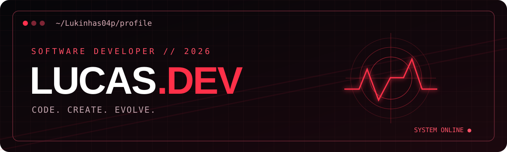

<div align="center">




### `> SYSTEM ONLINE_ `

**Estudante de Ciência da Computação · Desenvolvedor Web**

*Construindo experiências digitais com criatividade, atenção aos detalhes e vontade de evoluir.*


[](https://barbearia-artes.vercel.app/)
[](https://github.com/Lukinhas04p)
[](https://www.instagram.com/lukinhass_vp/)

</div>

**[SOBRE](#01--who-am-i) · [TECNOLOGIAS](#02--my-toolkit) · [PROJETOS](#03--selected-work) · [ATIVIDADE](#04--development-activity)**

---

### `01 // WHO AM I?`

```ts
const lucas = {
  github: "@Lukinhas04p",
  education: "Computer Science",
  interests: ["Web Development", "UI Design", "Software Engineering"],
  currentMission: "Learn, build and improve with every project",
};
```

Sou estudante de **Ciência da Computação** e gosto de transformar ideias em projetos reais. Tenho interesse em desenvolvimento web, interfaces modernas e experiências digitais bem construídas.

### `02 // MY TOOLKIT`

<div align="center">

**Linguagens e tecnologias**


**Ferramentas**


</div>

### `03 // SELECTED WORK`

<table><tr><td width="100%">

#### BARBEARIA ARTES `// WEB PROJECT`

Site institucional com catálogo de produtos, desenvolvido para apresentar a marca e seus serviços com uma experiência moderna e responsiva.

**Tecnologias:** Next.js · React · TypeScript · Tailwind CSS

**[VISITAR SITE ↗](https://barbearia-artes.vercel.app/)**

<sub>Repositório de código privado. O link acima leva apenas ao site publicado.</sub>

</td></tr></table>

### `04 // DEVELOPMENT ACTIVITY`

<div align="center">


<sub>Estatísticas geradas por serviço externo a partir dos dados disponíveis; projetos privados podem não aparecer.</sub>

</div>

---

<div align="center">

### `05 // LET'S BUILD SOMETHING`

**DESIGN. CODE. DEPLOY. REPEAT.**

[](https://github.com/Lukinhas04p)


</div>
